<h2>TensorFlow-FlexUNet-Image-Segmentation-TB-Chest-X-Ray (2026/11/15)</h2>
<h3>TB-Chest-X-Ray: AI Generated Pseudo Masks Segmentation Challenge</h3>
Sarah T. Arai 
Software Laboratory antillia.com  
This is the second experiment of Image Segmentation for <b>TB (Tuberculosis)-Chest-X-Ray </b>
 based on
our <a href="https://github.com/sarah-antillia/TensorFlow-FlexUNet-Image-Segmentation-Model">
TensorFlowFlexUNet Model</a>
 (<b>TensorFlow Flexible UNet Image Segmentation Model for Multiclass</b>) 
 and a 512x512-pixel PNG <a href="https://drive.google.com/file/d/1ARgKwVFHnkw8nqnVNYDEUCeYXugBlLJT/view?usp=sharing">
 <b>
TB-Chest-X-Ray-ImageMask-Dataset.zip
</b></a> 
with colored masks (<a href="https://creativecommons.org/licenses/by/4.0/">
Attribution 4.0 International (CC BY 4.0)</a>)
  which was derived by us from 
 the Kaggle  
  
<a href="https://www.kaggle.com/datasets/sairakiran1111/dataset-of-tuberculosis-chest-x-rays-images">
<b>
Dataset of Tuberculosis Chest X-rays Images
</b>
</a> by saira kiran1111 .
  

<b>Actual Image Segmentation for TB-Chest-X-Ray Images of 512x512 pixels</b> 
As shown below, the inferred masks resemble the ground-truth masks.  
 
<b>class_color_map = {Lung: cyan, Tuberculosis: yellow}</b>
 
 
<table>
<tr>
<th width="320" height="auto">Input: image</th>
<th width="320" height="auto">Mask (ground_truth)</th>
<th width="320" height="auto">Prediction: inferred_mask</th>
</tr>
<tr>
<td>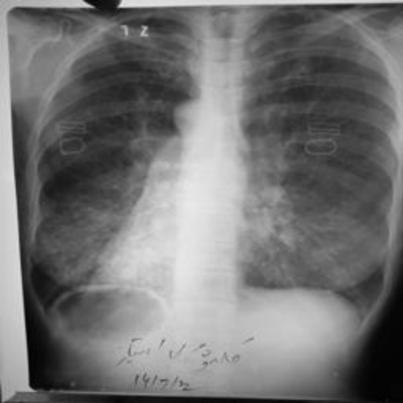</td>
<td>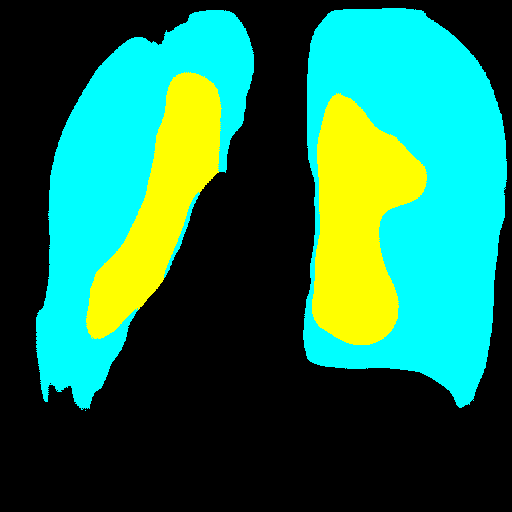</td>
<td>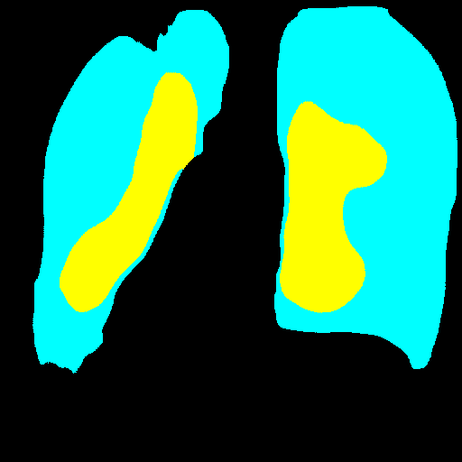</td>
</tr>
<tr>
<td>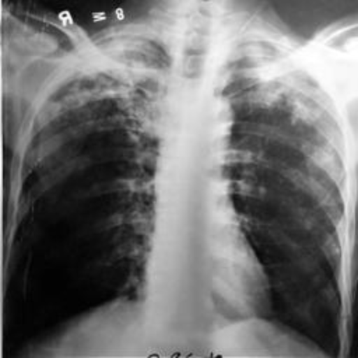</td>
<td>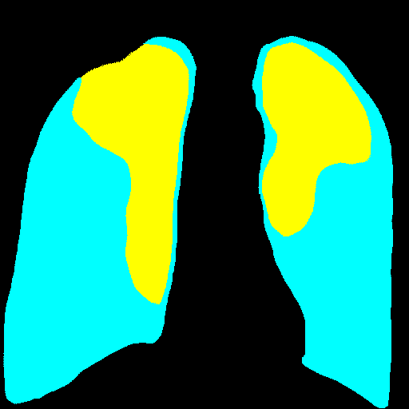</td>
<td>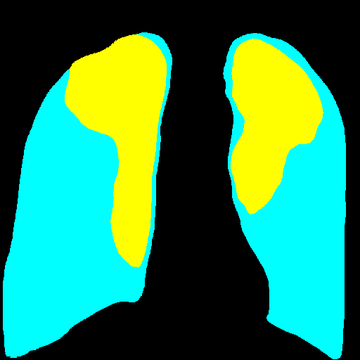</td>
</tr>
<tr>
<td>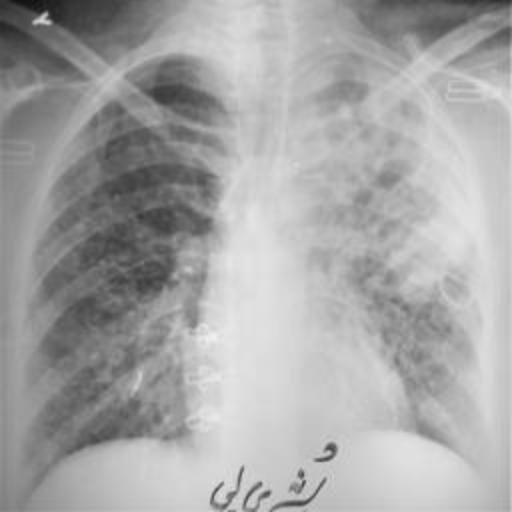</td>
<td>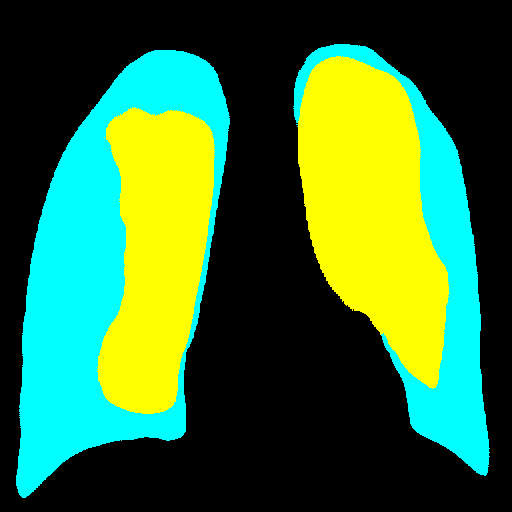</td>
<td>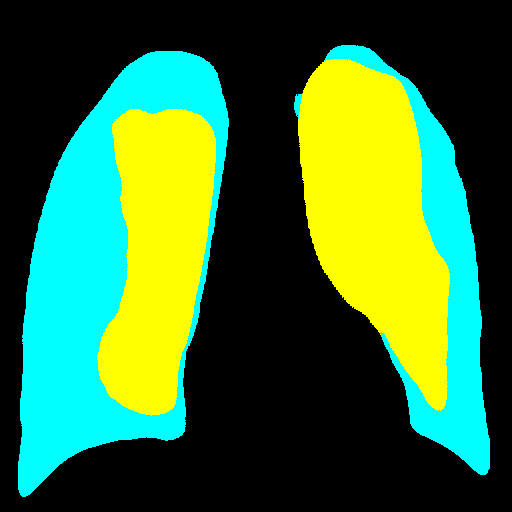</td>
</tr>
</table>

 
<h3>1. Dataset Citation</h3>
The dataset used here was derived from the following Kaggle:  

<a href="https://www.kaggle.com/datasets/sairakiran1111/dataset-of-tuberculosis-chest-x-rays-images">
<b>
Dataset of Tuberculosis Chest X-rays Images
</b>
</a> 
<b>Chest X-ray dataset of TB and normal cases for deep learning-based tuberculosis</b>
 
 by saira kiran1111
  
The following explanation (except)  was taken the website above.
  
<b>About Dataset</b> 
This dataset contains 2,494 chest X-ray images from tuberculosis (TB) patients and 514 normal 
chest X-ray images, collected from a local hospital in Pakistan. 
The dataset includes both TB-positive cases and healthy control images to support 
the development and evaluation of artificial intelligence-based approaches for 
tuberculosis detection and chest X-ray analysis.
 
 
All images have been processed and resized to a consistent dimension to improve data uniformity 
and facilitate machine learning and deep learning applications. The dataset has been anonymized 
to protect patient privacy, and no personally identifiable information is included.
  
<b>Dataset Details</b> 
Disease category: Tuberculosis (TB)
Imaging modality: Chest X-ray radiographs 
Total images: 3,008 
TB-positive images: 2,494 
Normal images: 514 
Image preprocessing: Resized to uniform dimensions 
Source: Local hospital, Pakistan 
Data format: Chest X-ray image files 
 
<b>Citation</b> 
Kiran, Saira; Jabeen, Dr Ishrat (2024), “Dataset of Tuberculosis Chest X-rays Images”,  
Mendeley Data, V2, doi: 10.17632/8j2g3csprk.2
  
<b>License</b> 
<a href="https://creativecommons.org/licenses/by/4.0/">
Attribution 4.0 International (CC BY 4.0)</a>
 
 
<h3>
2. Tuberculosis-Chest-X-Ray ImageMask Dataset
</h3>
<h3>2.1 Download ImageMask Dataset</h3>
 If you would like to train this Tuberculosis-Chest-X-Ray Segmentation model,
 please download the dataset from the Google drive:
 <a href="https://drive.google.com/file/d/1ARgKwVFHnkw8nqnVNYDEUCeYXugBlLJT/view?usp=sharing">
TB-Chest-X-Ray-ImageMask-Dataset.zip</a>.
Expand the downloaded, and put it under the <b>./dataset</b> folder.
 
<pre>
./dataset
└─Tuberculosis-Chest-X-Ray
    ├─test
    │   ├─images
    │   └─masks
    ├─train
    │   ├─images
    │   └─masks
    └─valid
        ├─images
        └─masks
</pre>
 
<b>Tuberculosis-Chest-X-Ray Statistics</b> 
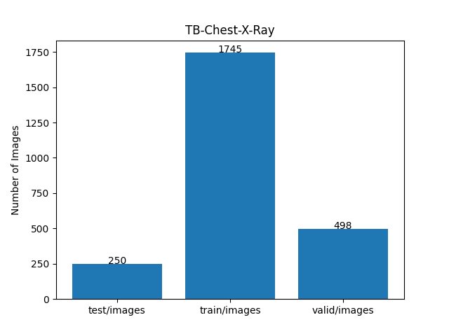 
 
As shown above, the number of images in the training and valid datasets is large enough to use for the
 training set of our segmentation model.
 
<h3>2.2 Derivation of ImageMask Dataset</h3>
The folder structure of the original dataset  is as follows, but it contains no annotation (mask) files.
<pre>
./Dataset of Tuberculosis Chest X-rays Images
    ├─Normal Chest X-rays ( 514 files)
    │   ├─others (1).jpg
...
    │   └─others (514).jpg
    └─TB Chest X-rays     ( 2,494 files)
        ├─TB.1.jpg
...
        └─TB.2500.jpg
</pre>
<b>Step 1</b> 
we generated a 512x512-pixel upscaled PNG master images dataset from the 256x256-pixel JPG files in <b>TB Chest X-rays</b> folder.
  
<b>Step 2</b> 
We generated the first pseudo masks corresponding to the master images in <b> TB Chest X-rays</b> folder 
by applying a segmentation (inference) method of the pretrained model 
<a href="https://github.com/sarah-antillia/TensorFlow-FlexUNet-Image-Segmentation-Tuberculosis-Chest-X-Ray">
TensorFlow-FlexUNet-Image-Segmentation-Tuberculosis-Chest-X-Ray
</a> to the master images.
  
<b>Step 3</b> 
We generated our own <a href="https://drive.google.com/file/d/1ARgKwVFHnkw8nqnVNYDEUCeYXugBlLJT/view?usp=sharing">TB-Chest-X-Ray-ImageMask-Dataset</a>
 from all pairs of the first pseudo masks and the master images.
  
<h3>2.3 Train Sample Images and Masks</h3>
<b>Train_sample_images</b> 
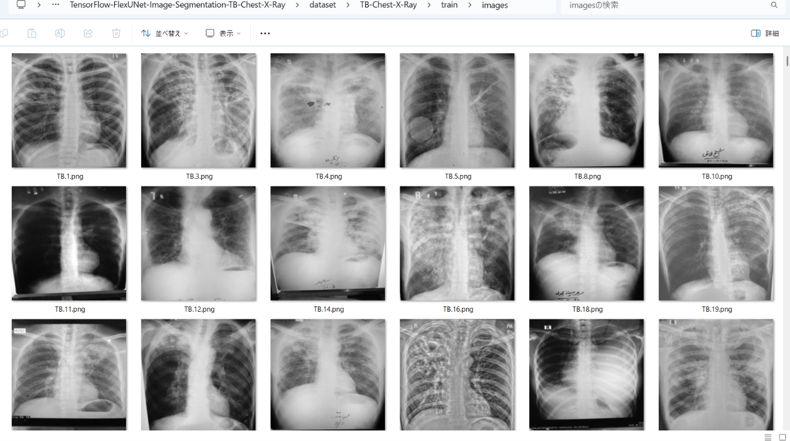
 
<b>Train_sample_masks</b> 
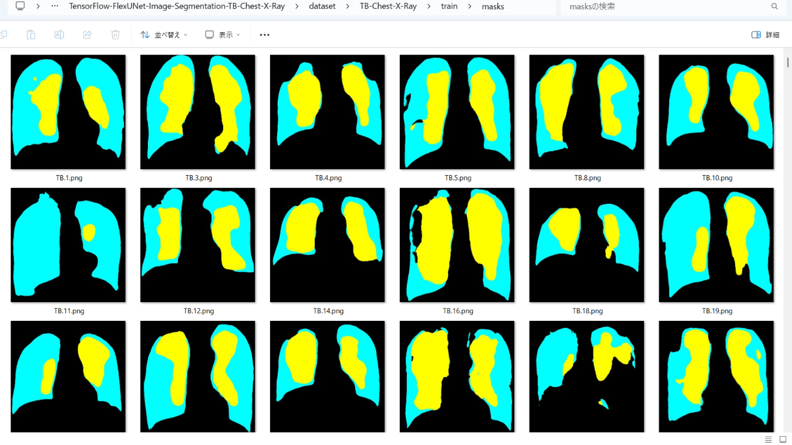
 
<h3>
3. Train TensorFlowFlexUNet Model
</h3>
 We trained the Tuberculosis-Chest-X-Ray TensorFlowFlexUNet model using the following
<a href="./projects/TensorFlowFlexUNet/TB-Chest-X-Ray/train_eval_infer.config"> <b>train_eval_infer.config</b></a> file.  
Please move to ./projects/TensorFlowFlexUNet/TB-Chest-X-Ray and run the following bat file. 
<pre>
>1.train.bat
</pre>
This runs the following command. 
<pre>
>python ../../../src/TensorFlowFlexUNetTrainer.py ./train_eval_infer.config
</pre>

<b>Model parameters</b> 
Defined a small <b>base_filters=16 </b> and large <b>base_kernels=(11,11)</b> for the first Conv Layer of Encoder Block of 
<a href="./src/TensorFlowFlexUNet.py">TensorFlowFlexUNet.py</a> 
and a large <b>num_layers=8</b> (including a bridge between Encoder and Decoder Blocks).
<pre>
[model]
; You may specify your own UNet class derived from our TensorFlowFlexModel
model         = "TensorFlowFlexUNet"
generator     =  False
image_width    = 512
image_height   = 512
image_channels = 3
num_classes    = 3
base_filters   = 16
base_kernels   = (11,11)
num_layers     = 8
dropout_rate   = 0.05
dilation       = (1,1)
</pre>
<b>Learning rate</b> 
Defined a small learning rate.  
<pre>
[model]
learning_rate  = 0.00007
</pre>
<b>Loss and metrics functions</b> 
Specified "categorical_focal_dice_loss" and <a href="./src/dice_coef_multiclass.py">"dice_coef_hybrid"</a>. 
<pre>
[model]
loss           = "categorical_focal_dice_loss"
metrics        = ["dice_coef_hybrid"]
hybrid_alpha   = 1.6
hybrid_beta    = 0.4
</pre>
<b>Dataset class</b> 
Specifed <a href="./src/ImageCategorizedMaskDataset.py">ImageCategorizedMaskDataset</a> class. 
<pre>
[dataset]
class_name    = "ImageCategorizedMaskDataset"
</pre>
 
<b>Learning rate reducer callback</b> 
Enabled the learning_rate_reducer callback and a small reducer_patience.
<pre> 
[train]
learning_rate_reducer = True
reducer_factor     = 0.4
reducer_patience   = 4
</pre>
<b>Early stopping callback</b> 
Enabled early stopping callback with the patience parameter.
<pre>
[train]
patience      = 10
</pre>
<b>RGB Color map</b> 
Specified RGB color map dict for Tuberculosis-Chest-X-Ray 1+2 classes. 
<pre>
[mask]
mask_datatyoe    = "categorized"
mask_file_format = ".png"
;Tuberculosis-Chest-X-Ray RGB color map dict for 1+2 classes.
; Background: black,  Lung:cyan,  Tuberculosis: yellow
rgb_map = {(0,0,0):0,(0,255,255):1, (255,255,0):2}
</pre>

<b>Epoch change inference callback</b> 
Enabled <a href="./src/EpochChangeInferencer.py">epoch_change_infer callback</a></b>. 
<pre>
[train]
epoch_change_infer       = True
epoch_change_infer_dir   =  "./epoch_change_infer"
num_infer_images         = 6
</pre>

By using this callback, on every epoch change, the inference procedure can be called
 for 6 images in the <b>mini_test</b> folder. This will help you confirm how the predicted mask changes 
 at each epoch during your training process.  
  
<!--
As shown below, early in the model training, the predicted masks from our FlexUNet segmentation model showed 
discouraging results.
 However, as training progressed through the epochs, the predictions gradually improved. 
   
 
-->
<b>Epoch_change_inference output at starting (epoch 1,2,3)</b> 
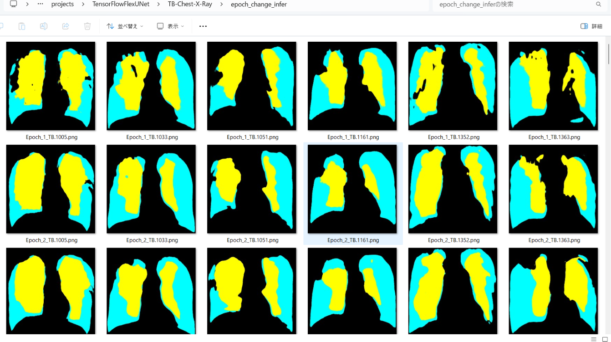 
 
<b>Epoch_change_inference output at middlepoint (epoch 18,19,20)</b> 
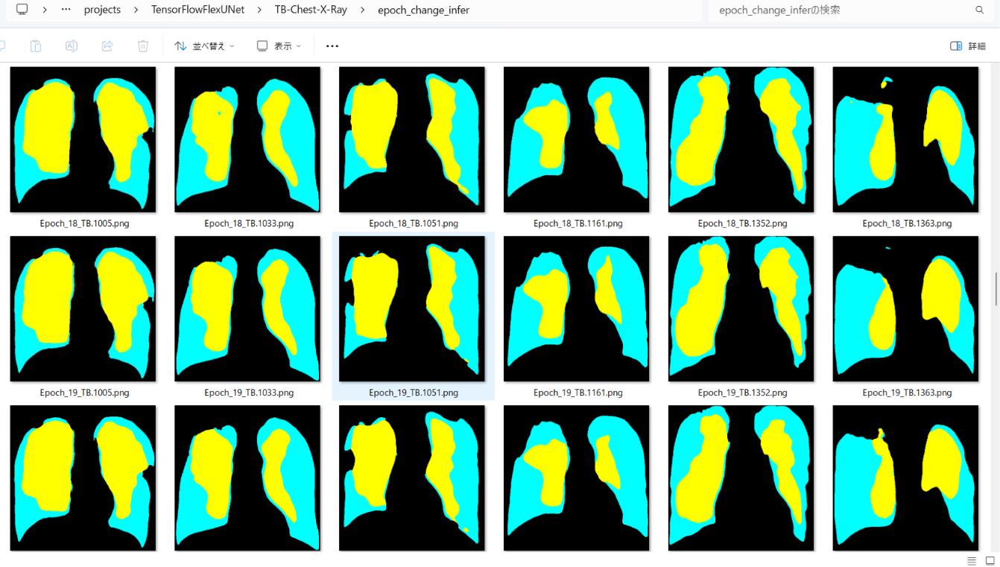 
 
<b>Epoch_change_inference output at ending (epoch 38,39,40)</b> 
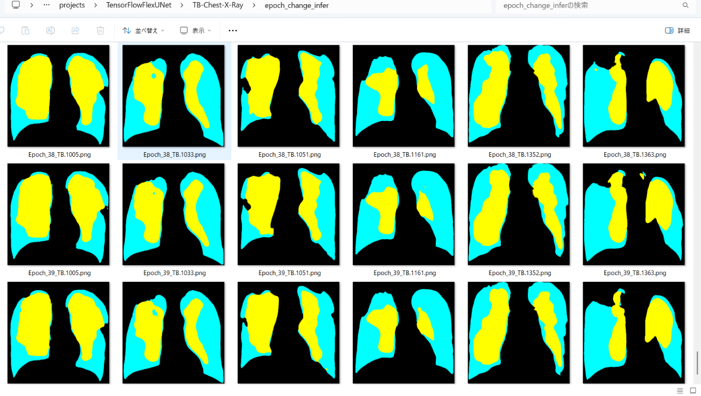 
 
In this experiment, the training process was stopped at epoch 40 by EarlyStoppingCallback. 
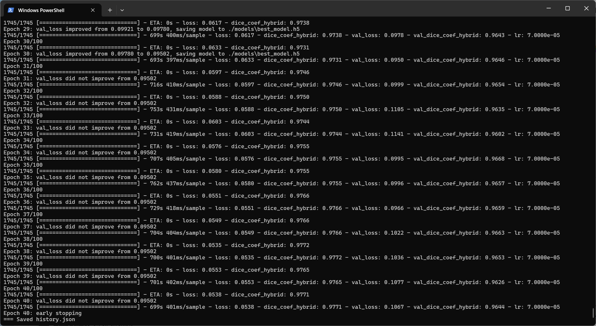 
 
<a href="./projects/TensorFlowFlexUNet/TB-Chest-X-Ray/eval/train_metrics.csv">train_metrics.csv</a> 
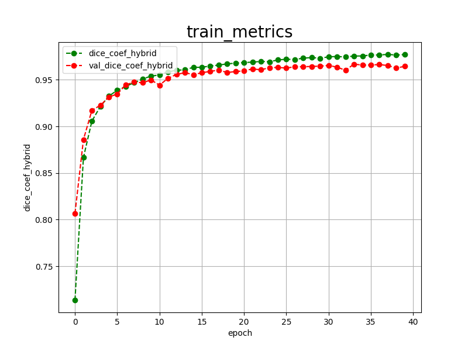 
 
<a href="./projects/TensorFlowFlexUNet/TB-Chest-X-Ray/eval/train_losses.csv">train_losses.csv</a> 
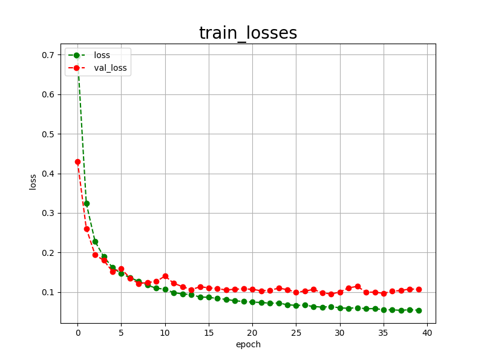 
 
<h3>
4. Evaluation
</h3>
Please move to <b>./projects/TensorFlowFlexUNet/TB-Chest-X-Ray</b> folder,
and run the following bat file to evaluate the TensorFlowUNet model for Tuberculosis-Chest-X-Ray. 
<pre>
>./2.evaluate.bat
</pre>
This runs the following command.
<pre>
>python ../../../src/TensorFlowFlexUNetEvaluator.py ./train_eval_infer.config
</pre>

Evaluation console output: 
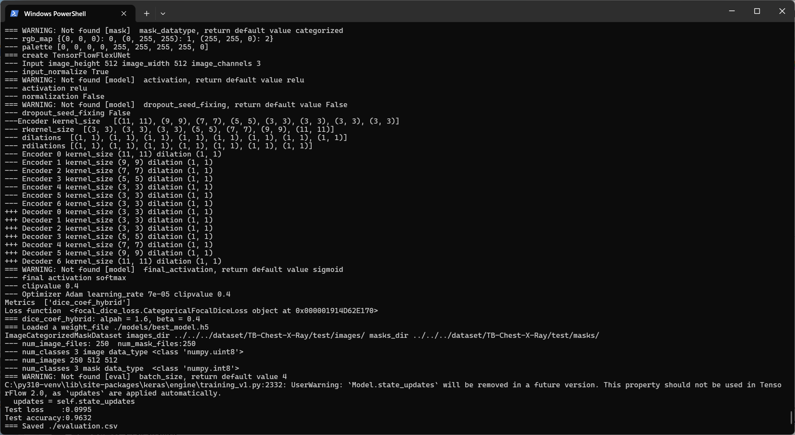
  Image-Segmentation-Tuberculosis-Chest-X-Ray

<a href="./projects/TensorFlowFlexUNet/TB-Chest-X-Ray/evaluation.csv">evaluation.csv</a> 
The loss (categorical_focal_dice_loss) on this Tuberculosis-Chest-X-Ray/test was low, 
and dice_coef_hybrid was high,
 as shown below.
 
<pre>
categorical_focal_dice_loss,0.0995
dice_coef_hybrid,0.9632
</pre>
 
<h3>
5. Inference
</h3>
Please move to <b>./projects/TensorFlowFlexUNet/TB-Chest-X-Ray</b> folder
and run the following bat file to infer segmentation regions for images using the trained TensorFlowUNet model for Tuberculosis-Chest-X-Ray. 
<pre>
>./3.infer.bat
</pre>
This runs the following command.
<pre>
>python ../../../src/TensorFlowFlexUNetInferencer.py ./train_eval_infer.config
</pre>

<b>mini_test_images</b> 
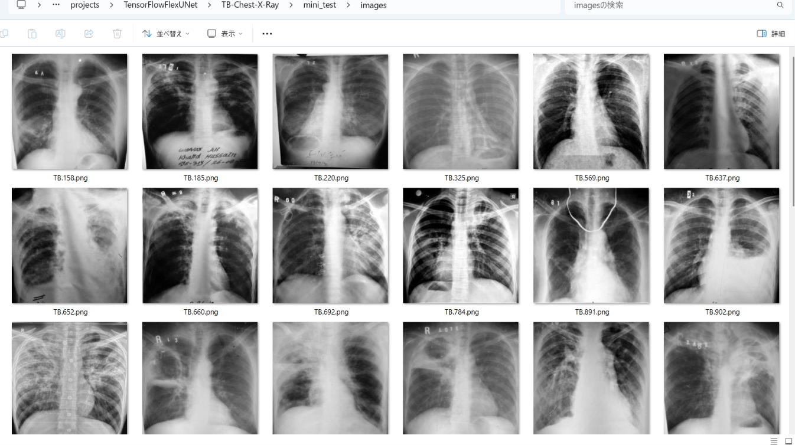 
<b>mini_test_mask(ground_truth)</b> 
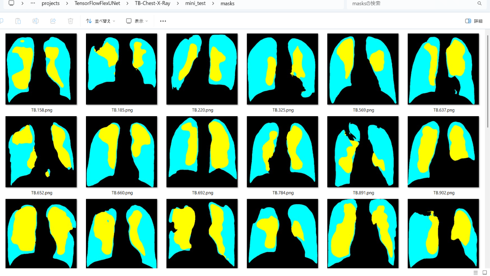 

<b>Inferred test masks</b> 
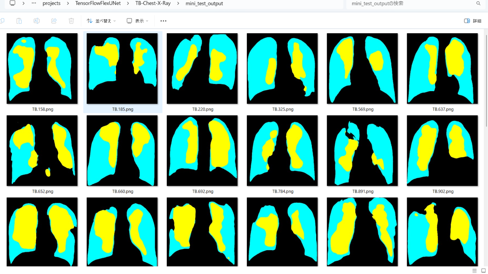 
 

<b>Enlarged images and masks for TB-Chest-X-Ray Images of 512x512 pixels</b> 
As shown below, the inferred masks look similar to the ground truth masks except for the first case. 
 
<b>class_color_map = {Lung: cyan, Tuberculosis: yellow}</b>
  
<table>
<tr>
<th width="320" height="auto">Image</th>
<th width="320" height="auto">Mask (ground_truth)</th>
<th width="320" height="auto">Inferred-mask</th>
</tr>
<tr>
<td>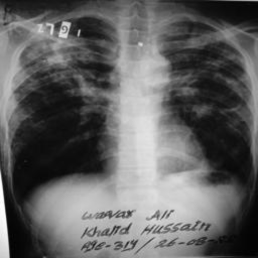</td>
<td>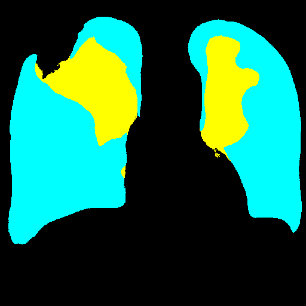</td>
<td>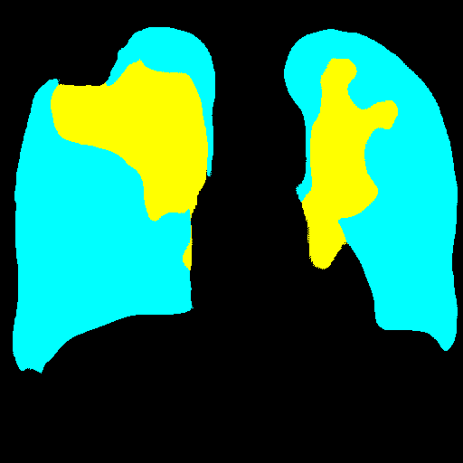</td>
</tr>
<tr>
<td></td>
<td></td>
<td></td>
</tr>
<tr>
<td>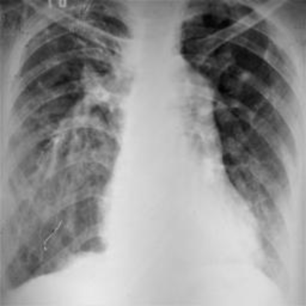</td>
<td>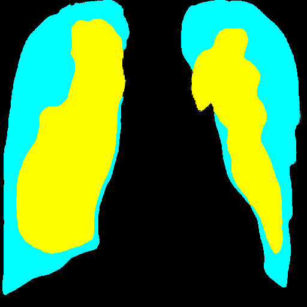</td>
<td>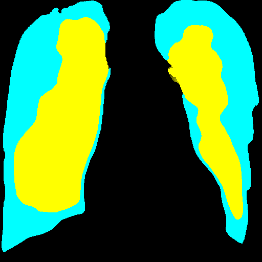</td>
</tr>
<tr>
<td>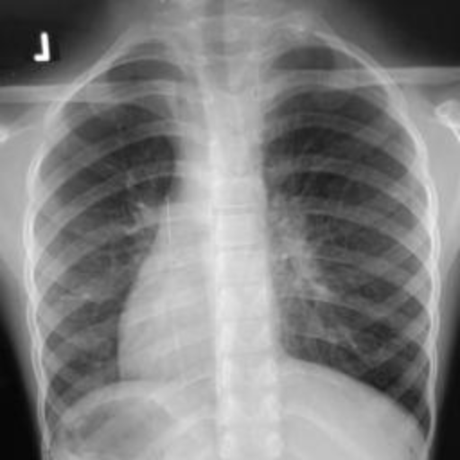</td>
<td></td>
<td>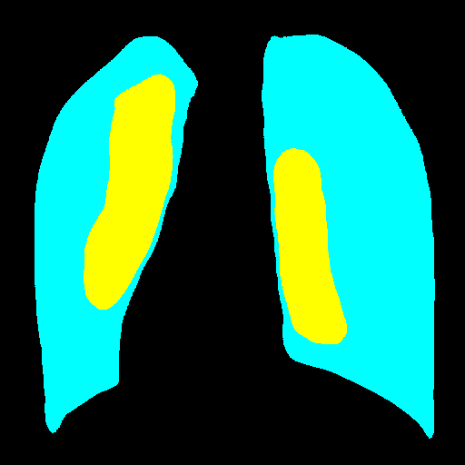</td>
</tr>
<tr>
<td>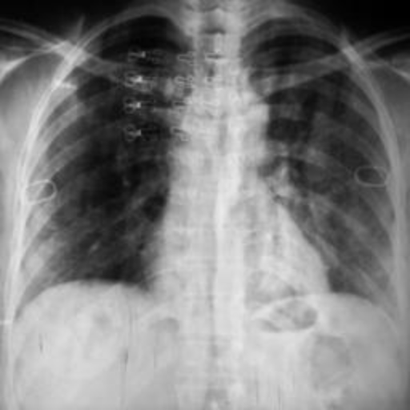</td>
<td>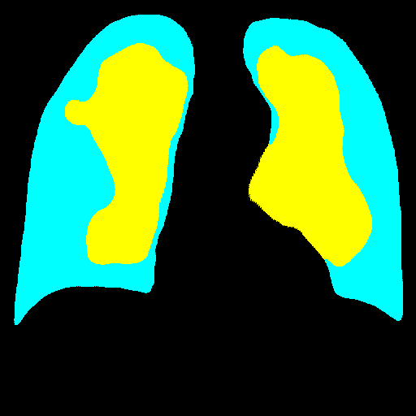</td>
<td>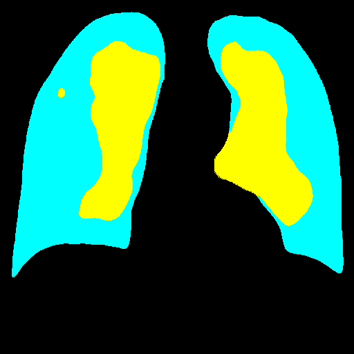</td>
</tr>
<tr>
<td>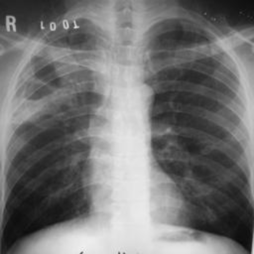</td>
<td>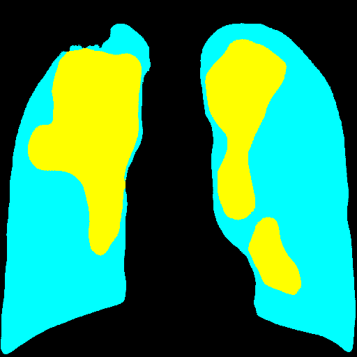</td>
<td>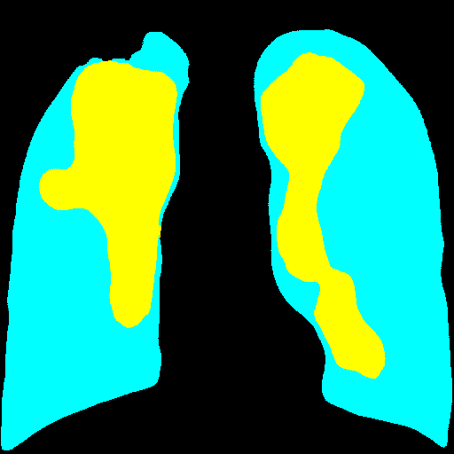</td>
</tr>
</table>

 
<h3>
References
</h3>
<b>1. Efficient and Accurate Pneumonia Detection Using a Novel Multi-Scale Transformer Approach</b> 
Alireza Saber, Pouria Parhami, Alimihammad Siahkarzadeh, Amirreza Fateh 
<a href ="https://arxiv.org/html/2408.04290v1">
https://arxiv.org/html/2408.04290v1
</a>
  
<b>2. Pneumonia detection from enhanced chest X-Ray images based on Double SGAN model</b> 
Zhijing Xu & Haoyang Zhang 
<a href="https://www.nature.com/articles/s41598-026-39785-w" >
https://www.nature.com/articles/s41598-026-39785-w
</a>
  
<b>3. Leveraging human expert image annotations to improve pneumonia 
differentiation through human knowledge distillation</b> 
Daniel Schaudt, Reinhold von Schwerin, Alexander Hafner, Pascal Riedel,  
Christian Späte, Manfred Reichert, Andreas Hinteregger, Meinrad Beer & Christopher Kloth 
<a href ="https://www.nature.com/articles/s41598-023-36148-7?fromPaywallRec=false">
https://www.nature.com/articles/s41598-023-36148-7?fromPaywallRec=false
</a>
  
<b>4. TensorFlow-FlexUNet-Image-Segmentation-Tuberculosis-Chest-X-Ray</b> 
Toshiyuki Arai 
<a href="https://github.com/sarah-antillia/TensorFlow-FlexUNet-Image-Segmentation-Tuberculosis-Chest-X-Ray">
https://github.com/sarah-antillia/TensorFlow-FlexUNet-Image-Segmentation-Tuberculosis-Chest-X-Ray</a>
  
<b>5. TensorFlow-FlexUNet-Image-Segmentation-Chest-X-Ray</b> 
Toshiyuki Arai 
<a href="https://github.com/sarah-antillia/TensorFlow-FlexUNet-Image-Segmentation-Chest-X-Ray">
https://github.com/sarah-antillia/TensorFlow-FlexUNet-Image-Segmentation-Chest-X-Ray</a>
   
<b>6. TensorFlow-FlexUNet-Image-Segmentation-Model</b> 
Toshiyuki Arai 
<a href="https://github.com/sarah-antillia/TensorFlow-FlexUNet-Image-Segmentation-Model">
https://github.com/sarah-antillia/TensorFlow-FlexUNet-Image-Segmentation-Model
</a>
  
